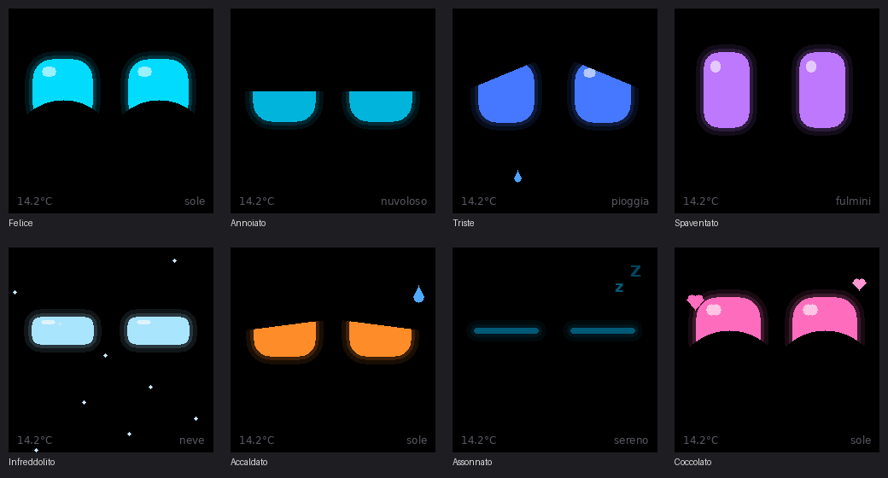
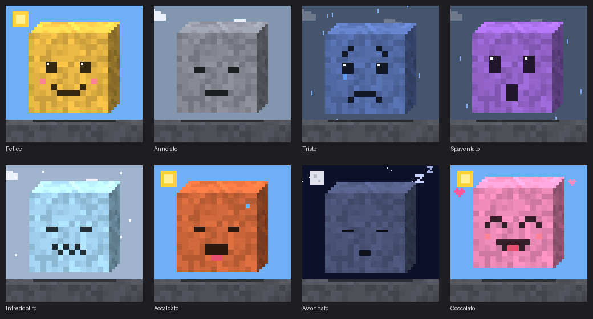

# NM-TV Weather Pet

Un desktop pet per il cubetto **NMMiner NM-TV-154** riflashato con **ESPHome**: due occhi robot animati che cambiano umore in base al **meteo** e alla **temperatura esterna** letti da Home Assistant.



> Anteprima generata dal codice del display su PC; i font reali sul dispositivo sono Roboto.

## Umori

| Umore | Quando | Occhi |
|---|---|---|
| Felice | sole, poco nuvoloso | mezzelune sorridenti, ciano |
| Annoiato | nuvoloso, nebbia, vento | palpebre a metà, sguardo lento |
| Triste | pioggia | angoli cadenti, blu, lacrima |
| Spaventato | temporale, eventi eccezionali | alti e stretti, viola, tremano |
| Infreddolito | neve, grandine o ≤ 3 °C | strizzati, ghiaccio, neve che cade |
| Accaldato | ≥ 30 °C | palpebre pesanti, arancio, sudore |
| Assonnato | notte serena | chiusi, "zZ" |
| Coccolato | tocco sul tetto | mezzelune rosa, cuoricini |

La temperatura vince sul meteo agli estremi.

## Animazione

- Bagliore attorno agli occhi e riflesso "vetro"
- Transizioni elastiche (molle) tra un'espressione e l'altra
- Saccadi dello sguardo con prospettiva e squash & stretch
- Battito di ciglia, ogni tanto doppio, e respiro
- **Reazioni brevi**: sorpresa (al cambio di meteo), sbadiglio, occhiolino, sospettoso, risveglio notturno. Partono da sole ogni 25–70 s circa in base all'umore

## Integrazione con Home Assistant

- **Selettore "Umore"**: forza un'espressione per provarle tutte (`Auto` per tornare al meteo)
- **Azione `esphome.nmtv_pet_reazione`** con `tipo: sorpresa | sbadiglio | occhiolino | sospettoso | risveglio`, da collegare ad automazioni (campanello, lavatrice finita…)
- **Binary sensor "Coccola"** per il tasto touch sul tetto
- **Luce "Retroilluminazione"** dimmerabile

## Stile alternativo: blocco voxel

In [`styles/voxel.yaml`](styles/voxel.yaml) c'è una variante in pixel art: un cubo voxel con faccia a pixel, materiale del blocco che cambia con l'umore (dissolvenza a tessere) e cielo animato che segue il meteo reale (sole, luna e stelle, nuvole, pioggia, neve, lampi, nebbia).



## Hardware

**NMMiner NM-TV-154** (PCB "NM-TV-Miner"): ESP32-D0WD-V3 (WROOM-32E, 4 MB flash, senza PSRAM), LCD IPS 1,54" 240×240 ST7789 su SPI.

| Funzione | GPIO |
|---|---|
| SPI SCLK / MOSI | 14 / 13 |
| LCD CS / DC / RST | 15 / 2 / — |
| Retroilluminazione (PWM, attiva LOW) | 19 |
| Alimentazione pannello (attiva LOW) | 21 |
| Tasto touch sul tetto | **da verificare** (default 4) |

Il pannello richiede **SPI mode 3**: con mode 0 resta nero. Il buffer è a 16 bit al 25% (circa 28 KB, disegno a 4 strisce) perché la scheda non ha PSRAM.

## Installazione

1. **Backup del firmware originale** (consigliato):
   ```
   esptool --chip esp32 read_flash 0x0 0x400000 nmtv-stock.bin
   ```
2. Copia `nmtv-weather-pet.yaml` in ESPHome e adatta gli entity ID in `substitutions`:
   - `weather_entity`: la tua entità `weather.*`
   - `temp_entity`: il sensore di temperatura esterna
3. Crea `secrets.yaml` partendo da [`secrets.yaml.example`](secrets.yaml.example). La chiave API va generata con `openssl rand -base64 32` (32 byte in base64). Non è il token di accesso di Home Assistant.
4. Primo flash via USB, poi aggiornamenti OTA.
5. In HA vai in *Impostazioni → Dispositivi e servizi* e **aggiungi il dispositivo all'integrazione ESPHome** con la stessa chiave. Senza questo passaggio i dati del meteo non arrivano (vedere il dispositivo in ESPHome Builder non basta).

### Trovare il pin del tasto touch

Il pin del tasto sul tetto non è documentato. Se GPIO4 non reagisce, in fondo al YAML c'è un blocco commentato che legge tutti i GPIO candidati: attivalo, tocca il tetto e guarda nel log quale cambia stato.

## Progetto gemello

[nmtv-energy-bot](../../../nmtv-energy-bot): lo stesso cubo, con l'umore guidato dai consumi elettrici di casa.

## Crediti

- Pin map dalla [guida ufficiale NMMiner per il firmware custom su NM-TV-154](https://www.nmminer.com/2026/03/02/how-to-develop-nm-tv-custom-firmware/)
- Note sull'hardware verificate in [smalltv-mod](https://github.com/giovi321/smalltv-mod)

Progetto non affiliato a NMMiner/NMTech. Il firmware ESPHome sostituisce completamente quello originale (il dispositivo smette di minare).

## Licenza

[MIT](LICENSE)
